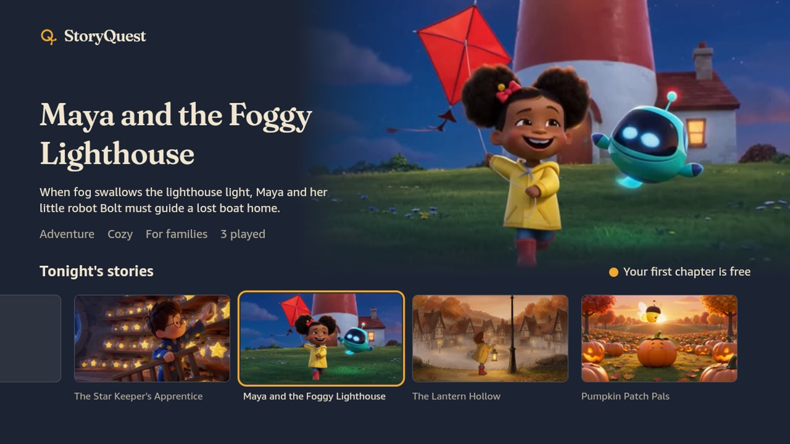
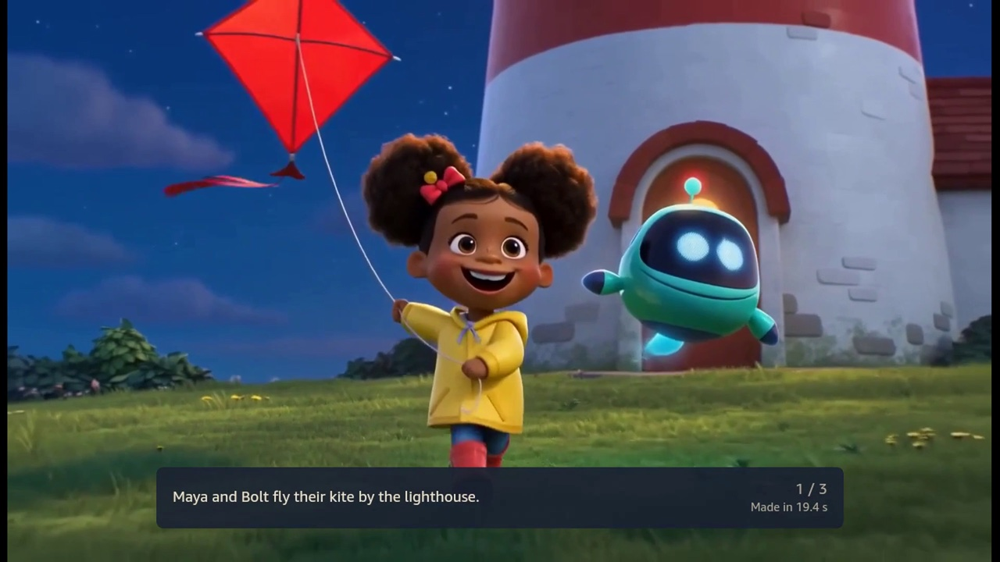
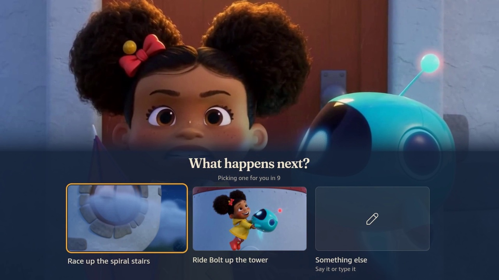
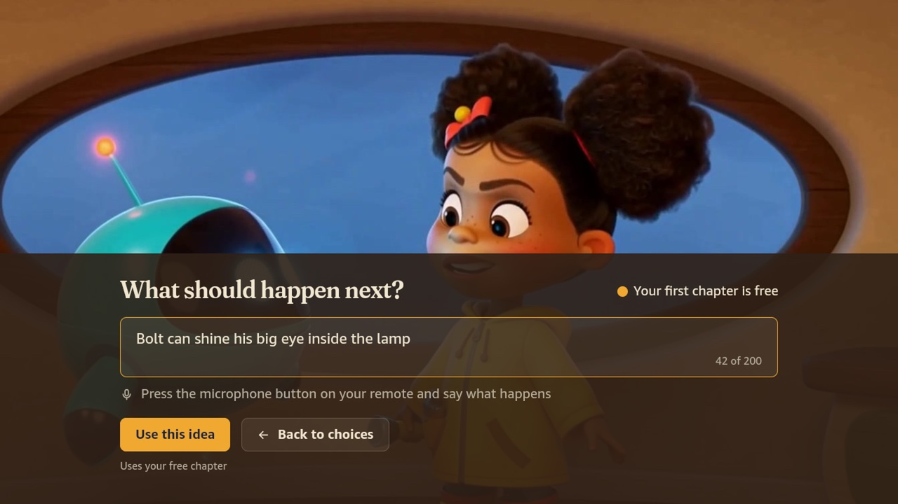
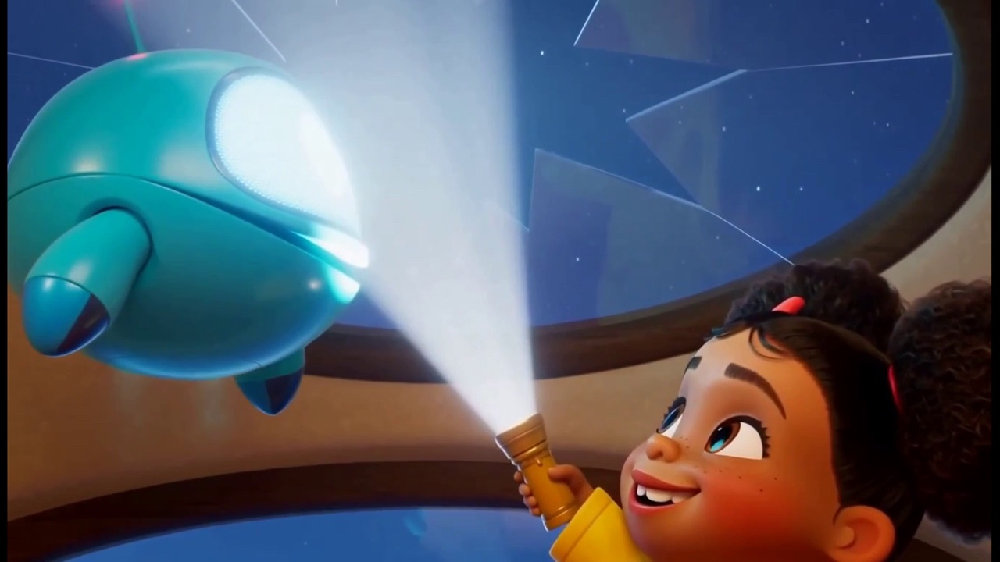
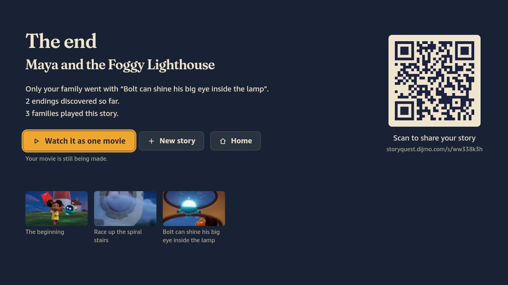

# StoryQuest

Family stories on Fire TV where every chapter is a short film made by AI, and the family decides what happens next.

* Demo video: [watch on YouTube](https://youtu.be/TZKUhnOkTNk)
* Website: [storyquest.dijmo.com](https://storyquest.dijmo.com)
* Made for the Fire TV track of the Amazon Developer hackathon "Build, Ship, Shape"

| | |
| --- | --- |
|  |  |
| Pick tonight's story | Watch a chapter: 45 seconds of film |
|  |  |
| Choose what happens next | Or say your own idea |
|  |  |
| The finale is filmed live from it | Share the whole story as one movie |

## What it does

* **Pick a story.** New stories wait on Home under Tonight's Stories.
* **Watch a chapter.** Each chapter is 45 seconds of film with music, sound and voices: three 15 second clips that play as one.
* **Choose what happens next.** Pick one of two choices with the remote, or choose Something else and say your own idea with the remote's microphone. The next chapter is written and filmed in seconds.
* **Or just watch.** If nobody presses anything, a countdown picks a filmed path.
* **Continue watching.** Your recent stories sit at the front of Home.
* **Share the ending.** A QR code opens the whole story as one movie on your phone.
* **Safe for kids.** An audience setting shapes every story, every idea and scene is checked before filming, and any scene can be reported.
* **Free to watch.** Chapters filmed just for your family cost 3 Sparks, bought with Amazon In App Purchasing. Your first one is free. No sign up.

## Try it

The release packages talk to our server, so you need no keys or accounts.

### On a Fire TV Stick with Vega OS

Works on Fire TV Stick 4K Select (2025), Fire TV Stick HD (2026) and Fire TV Stick 4K (2026).

1. Install the [Vega SDK](https://developer.amazon.com/docs/vega/0.24/install-vega-sdk.html) on your computer.
2. Put the stick in developer mode: run `vega devmode login` and follow the prompts.
3. Download `StoryQuest_armv7.vpkg` from the latest [release](../../releases).
4. Install and open it:

```bash
vega device install-app -p StoryQuest_armv7.vpkg
vega device launch-app -a com.storyquest.tv.main
```

### In the Vega Virtual Device

1. Install the Vega SDK and start the device: `vega virtual-device start`
2. Download `StoryQuest_x86_64.vpkg` (Intel Mac or Linux) or `StoryQuest_aarch64.vpkg` (Apple Silicon Mac) from the latest [release](../../releases).
3. Install and open it with the same two commands as above.

### What to try

1. On Tonight's Stories, select **Maya and the Foggy Lighthouse**.
2. Watch the first chapter: three clips that play as one film. When it ends, pick a choice with the remote, or let the countdown pick one for you.
3. Press Back at any time to pause, report a scene or go Home.
4. Go Home. Your story is first in the row. Select it to continue.
5. At the last choice, pick a finale, or choose Something else and say your own idea.
6. At the end, scan the QR code to watch the whole story as one movie.

Shared chapters are free while the free filming budget lasts. After that, a new chapter costs Sparks like anything filmed just for your family, and the app offers Sparks if you have none. If nothing can be filmed at all right now, the app says so and charges nothing, and everything already filmed keeps playing.

## Run it yourself

### You need

* Node 22 and Yarn 4 (`corepack enable`)
* ffmpeg
* The [Vega SDK](https://developer.amazon.com/docs/vega/0.24/install-vega-sdk.html) for the Fire TV app

### Start the server

```bash
yarn install
cp apps/server/.env.example apps/server/.env
yarn dev:server
```

The server runs at http://localhost:8080. With no keys it uses a stand in story writer and placeholder clips, so everything works offline.

### Use real AI

Set these in `apps/server/.env`:

| What | Setting |
| --- | --- |
| Video | `VIDEO=fal` and `FAL_KEY` |
| Story writer on OpenRouter | `DIRECTOR=openrouter` and `OPENROUTER_API_KEY` |
| Story writer on Amazon Bedrock | `DIRECTOR=bedrock` and `BEDROCK_API_KEY` or AWS credentials |
| Story writer on the Anthropic API | `DIRECTOR=anthropic` and `ANTHROPIC_API_KEY` |
| Any OpenAI compatible API | `DIRECTOR=openai`, `OPENAI_API_KEY` and `OPENAI_BASE_URL` |

`DIRECTOR_MODEL` picks the model. Our server uses DeepSeek V4.1 Flash on OpenRouter:

```bash
DIRECTOR=openrouter
DIRECTOR_MODEL=deepseek/deepseek-v4.1-flash
DIRECTOR_EFFORT=none
OPENROUTER_SORT=throughput
```

Every setting is explained in [apps/server/.env.example](apps/server/.env.example). Spending caps such as `TOTAL_VIDEO_SECONDS_CAP` keep costs bounded.

### Build the Fire TV app

Set your server address in `apps/vega/src/config.ts`, then:

```bash
yarn build:vega
vega virtual-device start
vega device install-app -p apps/vega/build/x86_64-release/vega_x86_64.vpkg
vega device launch-app -a com.storyquest.tv.main
```

The same screens also run in a browser for quick work on the interface: `yarn dev:web`.

### Run the tests

```bash
yarn test
```

### Run the server with Docker

```bash
docker build -f apps/server/Dockerfile -t storyquest-api .
docker run -p 8080:8080 --env-file apps/server/.env -v storyquest-data:/data storyquest-api
```

## How it works

1. **A plan first.** Before filming, a language model plans the whole story: the characters, the art style and what each of the four chapters must do, so every path reaches a real ending.
2. **One chapter at a time.** For each chapter it writes three shots, each with a caption and a video prompt, plus the next two choices.
3. **One continuous film.** MiniMax H3 Max Turbo on fal films each shot starting from the last frame of the shot before, so the clips flow together. The next shot is filmed while the current one plays.
4. **Shared paths.** A path one family picks is filmed once and then plays instantly for everyone. Your own ideas grow a private branch.

| Part | Folder |
| --- | --- |
| Fire TV app (Vega OS, React Native) | `apps/vega` |
| Screens and story logic shared by every TV | `packages/shared-ui` |
| Server, website and share pages (Node, Fastify, SQLite) | `apps/server` |
| Android TV and browser version for development | `apps/expo-multi-tv` |
| Types shared by the app and the server | `packages/contracts` |

## Business model

* Watching the daily stories is free.
* Families buy Sparks in the app with Amazon In App Purchasing: 10 Sparks for $11.99 or 25 for $24.99.
* A chapter filmed just for your family, from your own idea or a path nobody took yet, costs 3 Sparks. The first one is free.
* A filmed chapter costs us about $1.80 in video. Shared paths are filmed once and replay for every family, so free stories stay cheap.

## Next steps

* Publish StoryQuest on the Amazon Appstore for Fire TV.
* Family profiles, and characters who come back in new stories.
* Move the database from SQLite to PostgreSQL when StoryQuest runs on more than one server.

## Privacy

* No accounts and no personal data. Each TV gets a random id for limits and its own stories.
* Purchases use the anonymous id from Amazon In App Purchasing, never a name or email.
* What a family types or says is only used as story material.

## Credits

StoryQuest started from Amazon's [react-native-multi-tv-app-sample](https://github.com/AmazonAppDev/react-native-multi-tv-app-sample) ([MIT-0](docs/LICENSE-amazon-sample-MIT-0.txt)). We kept its project layout, remote control handling and video player setup. The screens, the story engine, the server and the website were built during the hackathon.

## License

MIT, see [LICENSE](LICENSE).
